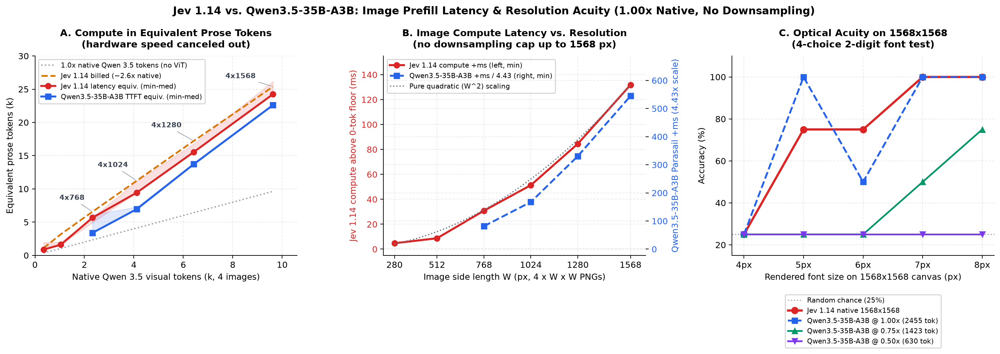

# Analysis of TypeSafe Jev's Billing Tokenizer

TypeSafe Jev bills substantially more input tokens than Qwen 3.5 processes on non-Latin text, CamelCase code, and images. Across our public benchmarks, Jev's billed counts average **1.96x** higher than Qwen 3.5 on non-Latin text (up to **3.67x** on Thai), **1.31x** higher on CamelCase production code (up to **1.42x** on Objective-C), and **2.63x** higher on images (up to **2.81x**), while plain English stays at **1.02x**. These higher counts also eat into Jev's 32,736-token per-question limit.

| Workload | Average vs. Qwen 3.5 | Peak | Notes |
|---|---:|---:|---|
| **Non-Latin text** (10 Wikipedia scripts) | **1.96x (+96%)** | **3.67x** (Thai) | Russian 2.51x, Ukrainian 2.13x, Arabic 1.98x |
| **CamelCase code** (12 repos, no comments) | **1.31x (+31%)** | **1.42x** (Objective-C) | Averages +39% vs. `o200k` across mobile, web, and backend repos |
| **Images** (4 standard resolutions) | **2.63x (+163%)** | **2.81x** (512x512) | Plus 32 to 35 extra tokens for UUID keys; matches ViT+MoE prefill time at 1568x1568 |
| **Plain English** (Wikipedia) | **1.02x (+2%)** | 1.02x | Close enough to go unnoticed in English testing |
| **Per-request framing** | +259 base | +7 / question | Added before any text or image tokens |

This repository reconstructs the exact token counter behind `jev-1.13` and `jev-1.14` for text, images, request framing, and `output_tokens`. Every finding comes strictly from public API responses (`api.typesafe.ai/v1/systemone` and `openrouter.ai/api/alpha/decisions`) and reproducible scripts under `scripts/` and `evidence/`; we do not have access to TypeSafe's server source code.

## How the billing counter works

Independent latency measurements by [Modaic](https://modaic.dev/blog/latency-doesnt-lie#qwens-tokenizer-predicts-jevs-latency-better-than-jevs-reported-counts) across 9,984 prompts show that Qwen 3.5's tokenizer predicts Jev's actual latency better than Jev's own reported `usage.input_tokens`, alongside throughput and self-identification evidence pointing to a Qwen 3.5 backbone.

Our reconstruction of `usage.input_tokens` matches `LabGuy94/jevtok`'s 600,000-call empirical bitmap of all 199,998 `o200k_base` tokens with **0 observable mismatches**, and matches live `jev-1.13` and `jev-1.14` responses identically on both direct `api.typesafe.ai` and OpenRouter.

In our view, the simplest explanation that fits both the latency evidence and the exact token-counting behavior is:

1. **Text billing looks like a custom gateway counter built to decouple billed counts from Qwen 3.5 (obscuring base-model fingerprinting), with an off-by-one bug in its fallback BPE filter.**

   Returning raw Qwen 3.5 counts makes the base model easy to fingerprint from `usage.input_tokens`. Swapping in plain `o200k_base` would diverge 2-3x on digits (`\p{N}{1,3}` vs. Qwen's single-digit `\p{N}`) and skip `NFC` normalization, breaking alignment with the 32,736-token limit.

   Instead, Jev's counter combines Qwen 3.5's `NFC` normalizer, regex pre-tokenizer, and reachable byte-token set `Q = bytes_256 ∪ {a + b : (a, b) ∈ qwen35_merges}` (247,843 tokens, excluding 201 merge-less entries in Qwen 3.5's vocab) with OpenAI `o200k_base`'s 199,998 merge ranks `O`:

   - **Pass 1 (whole-pretoken lookup):** if `piece in O and piece in Q`, emit 1 token.
   - **Pass 2 (fallback BPE in `o200k_base` rank order):** a candidate merge `cand` is allowed only if `cand in O` and every non-empty contiguous byte substring of `cand[:-1]` is in `Q`. That matches a three-line filter with two apparent mistakes: checking all contiguous substrings instead of BPE merge parents, and writing `< len(cand)` instead of `<= len(cand)`:

```python
def allowed_merge(cand: bytes) -> bool:
    if cand not in O:
        return False
    for i in range(len(cand)):
        for j in range(i + 1, len(cand)):   # skips every slice with j == len(cand)
            if cand[i:j] not in Q:
                return False
    return True
```

   That missing `+ 1` accounts for all three observed behaviors:
   - Substrings touching the final byte are never checked.
   - 10,551 non-Qwen `o200k_base` tokens (such as `abab`, `crip`, `onday`, and `):\n`) pass Pass 2 even though Pass 1 rejects non-Qwen chunks like `oworld`.
   - 91,846 shared `o200k ∩ Qwen 3.5` tokens are blocked inside longer chunks, fragmenting non-Latin words and CamelCase identifiers while Pass 1 catches most ordinary English words.

2. **Image billing uses a 28x28 `ceil` grid multiplied by 2x, plus the text token count of the asset key.**

   Jev bills `2 + T(asset_key) + 2 * ceil(W / 28) * ceil(H / 28)` for images between 280 and 1,568 pixels on each side (2.43x to 2.81x Qwen 3.5-VL's native 32x32 visual token count). Unlike the text bug, our latency and optical acuity tests against `qwen/qwen3.5-35b-a3b` indicate that Jev runs images at full 1.00x native resolution with no hidden downsampling, and the ~2.6x token ratio tracks real ViT+MoE prefill time on a 3B-active sparse MoE at 1568x1568. Using `ceil(· / 28)` with a 1,568 px ceiling (matching Anthropic Claude rather than Qwen 3.5's `round(· / 32)`) both reflects ViT compute and masks Qwen 3.5's 32-pixel patch steps.

   The one clear image billing bug is still charging `T(asset_key)` for the placeholder reference string after the image replaces it, which adds 32 to 35 extra tokens per image on UUID keys or OpenRouter's inline `image_url`.

## Benchmarks on Public Corpora

All 28 public corpora below (16 Wikipedia "Earth" articles and 12 open-source code files) were measured locally with `JevBillingTokenizer` and spot-checked live on the first 1,500 characters against `typesafe/jev-1.14`, with 28/28 exact matches (`evidence/workload_benchmarks.json`).

### 1. Wikipedia Articles (first 8,000 chars of "Earth")

| Wikipedia article | Qwen 3.5 | `o200k` | Jev | **Jev / Qwen 3.5** | **vs. `o200k`** | Live spotcheck |
|---|---:|---:|---:|---:|---:|---|
| **Thai** (`โลก`) | 288 | 448 | **1,056** | **3.67x (+266.7%)** | +135.7% | exact |
| **Russian** (`Земля`) | 2,119 | 2,143 | **5,327** | **2.51x (+151.4%)** | +148.6% | exact |
| **Ukrainian** (`Земля`) | 2,933 | 2,852 | **6,251** | **2.13x (+113.1%)** | +119.2% | exact |
| **Arabic** (`الأرض`) | 2,413 | 2,424 | **4,786** | **1.98x (+98.3%)** | +97.4% | exact |
| **Greek** (`Γη`) | 3,138 | 3,016 | **5,748** | **1.83x (+83.2%)** | +90.6% | exact |
| **Japanese** (`地球`) | 5,033 | 6,490 | **7,937** | **1.58x (+57.7%)** | +22.3% | exact |
| **Chinese** (`地球`) | 5,263 | 6,951 | **8,177** | **1.55x (+55.4%)** | +17.6% | exact |
| **Hebrew** (`כדור הארץ`) | 4,096 | 3,141 | **6,281** | **1.53x (+53.3%)** | +100.0% | exact |
| **Hindi** (`पृथ्वी`) | 3,673 | 2,754 | **5,388** | **1.47x (+46.7%)** | +95.6% | exact |
| **Korean** (`지구`) | 4,433 | 5,097 | **6,079** | **1.37x (+37.1%)** | +19.3% | exact |
| **Vietnamese** (`Trái Đất`) | 2,066 | 2,349 | **2,612** | **1.26x (+26.4%)** | +11.2% | exact |
| **Czech** (`Země`) | 2,647 | 2,662 | **3,316** | **1.25x (+25.3%)** | +24.6% | exact |
| **Polish** (`Ziemia`) | 2,507 | 2,662 | **3,065** | **1.22x (+22.3%)** | +15.1% | exact |
| **Turkish** (`Dünya`) | 2,495 | 2,381 | **3,037** | **1.22x (+21.7%)** | +27.6% | exact |
| **German** (`Erde`) | 2,133 | 2,025 | **2,287** | **1.07x (+7.2%)** | +12.9% | exact |
| **English** (`Earth`) | 1,756 | 1,685 | **1,784** | **1.02x (+1.6%)** | +5.9% | exact |

### 2. Open-Source Source Code (first 30 KB: raw vs. comments stripped)

Qwen's regex keeps CamelCase identifiers as single pre-tokens, so multi-word symbols enter Pass 2 whole and fragment when interior substrings are missing from `Q`. Stripping license headers and doc comments isolates the code ratio (averaging +31% vs. Qwen 3.5 and +39% vs. `o200k`):

| Open-source file (first 30 KB) | Raw vs. Qwen | Code-only Qwen 3.5 | Code-only `o200k` | Code-only Jev | **Code-only vs. Qwen 3.5** | **Code-only vs. `o200k`** | Live spotcheck |
|---|---:|---:|---:|---:|---:|---:|---|
| **Objective-C / iOS** (`Instagram/IGListKit` `IGListAdapter.m`) | 1.40x | 6,113 | 6,013 | **8,660** | **1.42x (+41.7%)** | **+44.0%** | exact |
| **Java / Spring** (`RequestMappingHandlerAdapter.java`) | 1.28x | 6,380 | 5,888 | **8,772** | **1.38x (+37.5%)** | **+49.0%** | exact |
| **Android Material** (`TextInputLayout.java`) | 1.27x | 6,436 | 6,168 | **8,809** | **1.37x (+36.9%)** | **+42.8%** | exact |
| **C# / .NET** (`dotnet/runtime` `HttpClient.cs`) | 1.31x | 5,559 | 5,283 | **7,606** | **1.37x (+36.8%)** | **+44.0%** | exact |
| **Android Material** (`NavigationBarView.java`) | 1.23x | 6,274 | 5,877 | **8,279** | **1.32x (+32.0%)** | **+40.9%** | exact |
| **Objective-C / iOS** (`AFNetworking` `AFHTTPSessionManager.m`) | 1.29x | 2,897 | 2,833 | **3,790** | **1.31x (+30.8%)** | **+33.8%** | exact |
| **C# / .NET WinForms** (`DataGridView.cs`) | 1.29x | 6,863 | 6,412 | **8,930** | **1.30x (+30.1%)** | **+39.3%** | exact |
| **Android Jetpack Compose / Kotlin** (`AndroidComposeView.android.kt`) | 1.26x | 6,070 | 5,834 | **7,850** | **1.29x (+29.3%)** | **+34.6%** | exact |
| **TypeScript** (`microsoft/vscode` `codeEditorWidget.ts`) | 1.30x | 7,018 | 6,676 | **9,051** | **1.29x (+29.0%)** | **+35.6%** | exact |
| **AndroidX** (`RecyclerView.java`) | 1.11x | 6,114 | 5,729 | **7,606** | **1.24x (+24.4%)** | **+32.8%** | exact |
| **Swift / iOS** (`Alamofire` `Session.swift`) | 1.15x | 5,053 | 4,605 | **6,253** | **1.24x (+23.7%)** | **+35.8%** | exact |
| **React / JS** (`facebook/react` `ReactFiberWorkLoop.js`) | 1.20x | 7,947 | 6,959 | **9,596** | **1.21x (+20.7%)** | **+37.9%** | exact |

## Image Tokenization and Request Constants

### Image formula and bounds

```math
\text{image tokens}(W, H, \text{key}) = 2 + T(\text{key}) + 2 \times \left\lceil \frac{W}{28} \right\rceil \times \left\lceil \frac{H}{28} \right\rceil
```

Jev accepts images between 280 and 1,568 pixels on both width and height (10 to 56 multiples of 28) and rejects anything even one pixel outside that range with HTTP 400. Counts are identical across PNG and JPEG, solid color and noise, `noul` and `box`, `state` and `instructions`, and `jev-1.13` and `jev-1.14`; referencing the same asset twice bills it twice.

Because `T(key)` is billed on top of the image patches, long reference names inflate per-image cost. A UUID asset key adds 34 extra tokens over a 1-token key like `"a"`, and OpenRouter's inline `image_url` shorthand (which auto-generates a UUID key inside a list) adds 32 extra tokens per image. All 49 live resolution, 1-pixel step boundary, key-variant, and constant checks are recorded in `evidence/image_and_parity_probes.json`.

| Resolution | Qwen 3.5-VL native (`32x32` + 2) | Qwen 2.5-VL / Claude (`28x28`) | Jev visual tokens (`2 + 2*ceil(W/28)*ceil(H/28)`) | Ratio vs. Qwen 3.5-VL |
|---|---:|---:|---:|---:|
| `280 x 280` | 83 | 100 | **202** *(+ `T(key)`)* | **2.43x** |
| `512 x 512` | 258 | 361 | **724** *(+ `T(key)`)* | **2.81x** |
| `1024 x 1024` | 1,026 | 1,369 | **2,740** *(+ `T(key)`)* | **2.67x** |
| `1568 x 1568` | 2,403 | 3,136 | **6,274** *(+ `T(key)`)* | **2.61x** |

### Image latency, resolution acuity, and the 28 px grid

To check whether Jev 1.14 downsamples images behind the scenes or runs them at full resolution, we compared `jev-1.14.0` (`api.typesafe.ai`) against `qwen/qwen3.5-35b-a3b` (OpenRouter pinned to Parasail, which runs native 32x32 resolution at 1568x1568) on both prefill latency and fine-detail optical acuity (`evidence/image_latency_and_acuity.json`).



1. **No hidden downsampling up to 1568x1568:** Jev's compute latency climbs quadratically all the way from 280 px to 1568 px with no flat cap. On a 4-choice 2-digit eye-chart rendered at 4-8 px bold Arial on a 1568x1568 canvas, Jev matches stock `qwen/qwen3.5-35b-a3b` at 1.00x native resolution (100% accuracy at 7-8 px), whereas 0.75x downsampling drops 5-7 px sharply and 0.50x collapses to random chance through 8 px. Jev also distinguishes 1-pixel vertical from horizontal stripes on 1568x1568 (`P = 0.97` and `0.95`).
2. **Why the 28 px x 2x rule tracks compute while masking Qwen 3.5's grid:** Converting `4 x 1568x1568` compute time into equivalent prose tokens using each model's own text prefill slope gives 24.2k-26.1k prose-token equivalents (2.52x-2.72x per Qwen visual token) on Jev 1.14, versus 22.6k-22.8k (2.35x-2.37x) on stock `qwen/qwen3.5-35b-a3b`. On a 3B-active sparse MoE, text prefill is cheap while each 1568x1568 image runs a dense 27-layer ViT on 9,604 unmerged 16x16 patches with quadratic self-attention. Because `2 * (32 / 28)^2 = 2.61x`, the 28 px x 2x rule roughly tracks high-resolution ViT compute while hiding Qwen 3.5-VL's 32 px `round()` boundaries behind Anthropic Claude's 28 px `ceil()` grid and 1,568 px ceiling.

### Request billing constants

```math
\text{input tokens} = 259 + S_{\text{state}} + \sum_{q} \bigl(7 + T(\text{instructions}_q) + E_q\bigr)
```

| Component | Formula / constant | Live `jev-1.14` check |
|---|---|---|
| Per-request base | **259** | 1 `box` (empty instructions) = 266 |
| Per question | **+7** + `T(instructions)` | 1 / 2 / 3 `noul` (1-tok instr): 267, 275, 283 |
| `noul` (no criteria) / `box` extra ($E_q$) | **+0** | 267 (`noul`), 266 (`box`) |
| `choice` extra (no descriptions) | **+4** + `sum(5 + T(opt_key))` | 2 opts: 282; 3 opts: 288 |
| `choice` legend (any non-empty desc) | **+6** + `sum(5 + T(desc))` | 2 opts with 1-tok desc: 300 (+18) |
| `score` legend | **+6** + `sum(5 + T(level))` | 2 levels: 284; 3 levels: 290 |
| Structured `state` | root +0, nested +2, sep +1, key `T(k)+3`, str `T(s)+2` | `state=""` (270) vs `state=[""]` (272) |
| `output_tokens` (unbilled, `noul`) | **4 + 15 * N + `sum(T(qid))`** | 1 / 2 / 3 `noul` (1-tok IDs): 20, 36, 52 |

### Comparison with other public tokenizers

No public model tokenizer matches Jev's text counter (0 matches across 192+ public tokenizers in prior studies), and no standard BPE, Unigram, or WordPiece model produces the Pass 1 vs. Pass 2 split (`inqu` = 1 standalone, `inquxyz` = 3). On images, Anthropic Claude shares the 28x28 `ceil` grid and 1,568 px cap and Qwen 2.5-VL shares the 28 px factor, but neither doubles patch counts, hard-rejects outside 280-1,568 px instead of resizing, or bills the asset key string.

## Verification Details

### 1. Full 199,998-token diff

Comparing `jev_billing_tokenizer.py` against [`LabGuy94/jevtok`](https://github.com/LabGuy94/jevtok)'s 600,000-call bitmap (`jev-1.13.bin`, full output in `evidence/full_vocab_verification.json`):

| Check across `o200k_base` (199,998 tokens) | Result |
|---|---:|
| `LOOKUP` discrepancies (all 144,710 valid NFC single pretokens) | **0** |
| `FORMED` discrepancies (all 53,820 valid NFC UTF-8 tokens) | **0** |
| Multi-byte invalid-UTF-8 tokens (840 in both, 391 in neither, 203 inert) | **0 false positives** |
| Merge-less Qwen 3.5 vocab entries appearing in `LOOKUP` | **0 / 62** |
| Non-Qwen `o200k_base` tokens leaking into `FORMED` | **10,551** |
| Shared `o200k ∩ Qwen 3.5` tokens blocked in Pass 2 | **91,846** |

Every single-missing-substring exclusion inside `o200k_base` matches `jev-1.13.bin`:

| Missing substring position | Blocked tokens | Example |
|---|---:|---|
| Full prefix `cand[:-1]` | 7,995 | `Java` blocked by missing `Jav` |
| Strict prefix `cand[:k]` | 1,122 | `create` blocked by missing `crea` |
| Suffix of `cand[:-1]` | 6,167 | `inqu` blocked by missing `nq` |
| Strictly interior slice | 472 | `errors` blocked by missing `rro` |

### 2. Live probes and endpoint parity

All live discriminating checks matched our reconstruction 100%: 71 state probes and 11 `output_tokens` probes in `evidence/live_probes.json`, plus 20 `jev-1.13` vs. `jev-1.14` parity probes (`box` is the only version difference, returning 400 on 1.13 and succeeding on 1.14) and 21 direct `api.typesafe.ai` vs. OpenRouter parity probes in `evidence/image_and_parity_probes.json`. Matching direct TypeSafe and OpenRouter token-for-token confirms the billing counter runs inside TypeSafe's upstream server rather than OpenRouter.

### 3. Why simpler explanations are ruled out

1. **Not a sequential two-tokenizer pipeline:** On `inquxyz`, `errorsxyz`, `icientsxyz`, and `ierendenxyz`, both Qwen 3.5 and `o200k_base` emit 2 tokens, while Jev emits 3. Conversely, on `yarakat`, ` terdapat`, and ` dikkat`, Qwen 3.5 emits 3 tokens while Jev merges across Qwen's boundaries into 2.
2. **Not stock `tiktoken` with one `mergeable_ranks` dict:** Standalone `Java`, `inqu`, `errors`, `icients`, and `ierenden` count as 1 token (Pass 1), yet the exact same adjacent pieces refuse to merge inside a longer pretoken (Pass 2).
3. **Not stock HuggingFace `tokenizers` with swapped `vocab`/`merges`:** 10,551 tokens in `FORMED` (such as `abab`, `crip`, and `onday`) do not exist in Qwen 3.5's vocab, while `inqu`, `errors`, and `icients` exist with identical splits in both tokenizers.
4. **Not a `byte_pair_merge` indexing bug or prefix-trie bug:** For `icientsxyz`, `errorsxyz`, and `ierendenxyz`, every node in both merge trees exists in both vocabularies, the blocking interior slices (`cien`, `rro`, `erend`) cross early merge boundaries, and each is a valid prefix of another Qwen 3.5 token (`cient`, `rror`, `erende`). Because `FORMED` is the logical AND over all $\binom{L}{2}$ slices `cand[i:j]` ($0 \le i < j < L$), any reproducing code must test all $\binom{L}{2}$ substrings against `Q`.

## Reproducing Locally

Requires Python 3.10+ and [`uv`](https://docs.astral.sh/uv/). `Qwen/Qwen3.5-9B`'s `tokenizer.json` is downloaded automatically via `huggingface_hub`.

```bash
# 1. Verify across all 199,998 o200k_base tokens vs LabGuy94/jevtok jev-1.13.bin
uv run python scripts/verify_full_vocab.py

# 2. Benchmark 12 open-source files (raw & comment-stripped) + 16 Wikipedia articles
#    (set OPENROUTER_API_KEY to live spotcheck all 28)
uv run python scripts/benchmark_workloads.py

# 3. Run all 82 live discriminating text probes (~$0.001 total)
export OPENROUTER_API_KEY=...
uv run python scripts/run_live_probes.py

# 4. Run image tokenization, billing constants, jev-1.13/1.14 & direct TypeSafe parity probes
export OPENROUTER_API_KEY=...
export TYPESAFE_API_KEY=...   # optional; enables direct api.typesafe.ai parity checks
uv run python scripts/run_image_and_parity_probes.py

# 5. Regenerate the image latency and optical acuity figure
uv run python scripts/plot_image_latency_and_acuity.py
```

## Files

- `jev_billing_tokenizer.py`: standalone implementation of Jev's text and image token counter.
- `scripts/verify_full_vocab.py`: 199,998-token diff against `LabGuy94/jevtok` (`jev-1.13.bin`).
- `scripts/run_live_probes.py`: live text, `output_tokens`, and version parity probes.
- `scripts/run_image_and_parity_probes.py`: live image, billing-constant, version-parity, and endpoint-parity probes.
- `scripts/benchmark_workloads.py`: 12 open-source code files (raw and comment-stripped) and 16 Wikipedia articles with live spotchecks.
- `scripts/plot_image_latency_and_acuity.py`: generates `evidence/image_latency_and_acuity.png` from `evidence/image_latency_and_acuity.json`.
- `evidence/`: JSON outputs and plot for every check above.
